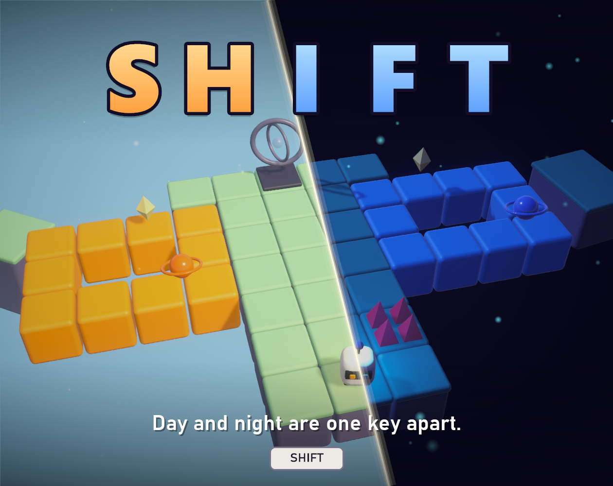
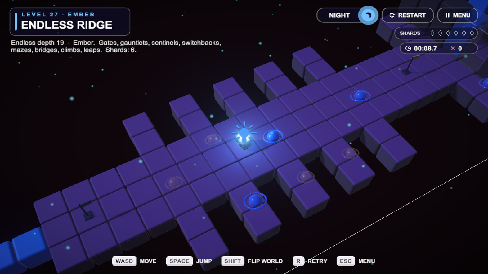
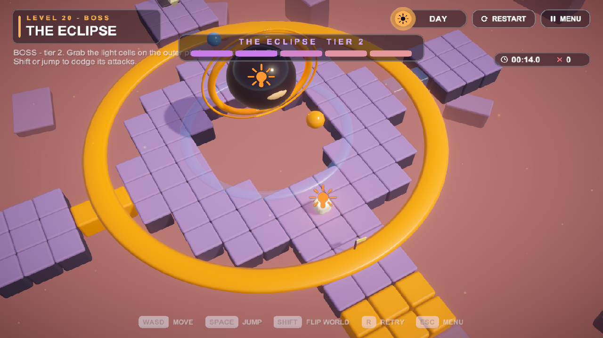
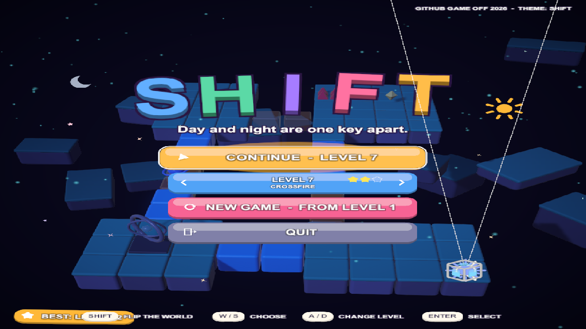
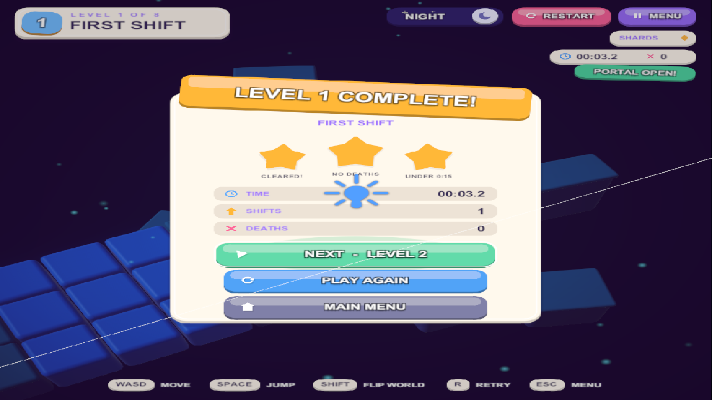

# SHIFT

*Day and night are one key apart.*

A 3D puzzle-platformer made in Unity for **[GitHub Game Off 2026](https://itch.io/jam/game-off-2026)**. The jam theme is **SHIFT**.



## The idea

You are a small lantern-bot crossing floating islands. One key, **SHIFT**, flips the entire world between **Day** and **Night**:

- **Amber** blocks and walls exist only by **day**.
- **Blue** blocks and walls exist only by **night**.
- **Orbs** patrol the islands, but they can only hurt you in their own phase.
- You can shift in mid-air. Jump, flip the world, and land on ground that wasn't there a moment ago.
- You can't shift if a block would materialise inside you. The world refuses and shakes.

Collect every shard to open the portal. 8 hand-made campaign levels teach every mechanic, and then the game becomes **endless**.

### Endless mode

After level 8 the levels never stop. Each one is generated procedurally and is harder than the last.

- **Winding layouts.** Levels are chains of sections that turn left and right. Each section is built in its own space, then rotated into place after a collision check, so paths never overlap.
- **Nine section types**, each solvable by construction:
  - day/night bridges
  - mid-air leaps (with sideways hops later)
  - switchback paths that change phase at every bend
  - staircases up and down
  - wall gates with orb lanes
  - sentinel bridges
  - orb **gauntlets**, where later lanes hold a day *and* a night orb, so you have to time it
  - spike fields
  - phase mazes

  Spike fields and mazes are checked with a search over (cell, phase), so a route always exists.
- **Themes.** Each level picks a look (Meadow, Dunes, Frost, Dusk, Ember) and a random starting phase.
- **Difficulty rises** with every level: more sections, narrower bridges, more frequent flips, more and faster orbs, denser spikes, and more shards.
- **Checkpoint flags** sit on every pad. Generation is seeded by the level number, so level 23 is the same for everyone.



### Boss fight every 10 levels: The Eclipse

Levels 10, 20, 30 and so on are boss arenas. The Eclipse floats over a ring arena and:

- fires volleys of **day and night projectiles**. Each one only hurts in its own phase.
- sends out **shock-rings** across the floor. Shift to their opposite phase, or jump over them.
- casts the **Eclipse**: it forcibly flips the world on you.
- always telegraphs its next attack with the colour of its corona.

To hurt it, grab the **light cells** that appear on the outer platforms. Each platform is reachable only across a day or a night bridge, and each cell you collect fires a beam at the boss. Every tier adds HP and faster, denser attacks. Defeat it to open the portal.



The sky, lighting, sun angle, fog, particles, and music all crossfade when you shift. Each phase has its own soundtrack, and the two loops play in sync so the music shifts with the world.

## Controls

| Action | Keyboard | Gamepad |
|---|---|---|
| Move | WASD / Arrow keys | Left stick / D-pad |
| Jump | Space | A / Cross |
| **Shift world** | **Shift** (or E / J) | X / Square, bumpers, RT |
| Restart level | R | Select |
| Pause menu | Esc / P (or the MENU button) | Start |
| Restart from Level 1 | RESTART button, or Pause menu | Pause menu |

Menus work with the mouse, the keyboard (W/S or arrows, Enter, Esc) and a gamepad. The title screen has Continue, a level select for every level you have reached, and New Game. The pause menu can restart the level, restart the whole run from Level 1 (it asks first), or return to the title.

Every level earns **1 to 3 stars**: one for clearing it, one for no deaths, and one for beating the par time. Your best stars are saved and shown in level select. The UI is drawn entirely in code in a bright "candy" style: 3D buttons that bounce and wiggle, confetti, level banners that swoop in, and sparkles when you flip the world or grab a shard.




## Tech notes

- **Engine:** Unity 6 (6000.6.8f1), Universal Render Pipeline, Input System.
- **No imported art or audio.** Every mesh (rounded blocks, gems, portal rings, orbs, spikes, the player) is generated in code (`MeshFactory.cs`). Every sound effect and both music tracks are synthesised at startup (`Synth.cs`).
- The scene holds a single `GameManager` that builds the camera, lights, post-processing, UI, and levels at runtime.
- Levels are ASCII grids with multiple layers. See the format notes at the top of `Assets/Scripts/Game/Levels.cs`. Adding a level is a matter of drawing it.
- The cover art is rendered in-engine: `AgentScripts/Cover.cs` renders the same shot in Day and in Night, and `AgentScripts/make_cover.ps1` splits them along a diagonal and adds the title.
- `LevelGenerator.cs` builds endless levels and writes out a scripted solution for each one. `ShiftGame/AgentScripts/Bot.cs` is a playtest bot that drives simulated input. It completes all 8 campaign levels and plays the generated solutions to verify that endless levels can be beaten.

## Project layout

```
ShiftGame/                Unity project
  Assets/Scripts/Core     input, phase state, palette, materials, mesh + audio generators
  Assets/Scripts/Game     GameManager, player, camera, entities, HUD, levels, audio
  Assets/Editor           ShiftSetup: menu "SHIFT/..." to set up the project and build Windows/WebGL
  AgentScripts/           playtest bot (outside Assets, not compiled into the game)
Screenshots/
```

## Building

Open `ShiftGame` in Unity 6000.6.8f1, then use the **SHIFT** menu:

- **Setup Project** recreates the base materials, the scene, and the player settings.
- **Build Windows** writes to `Builds/Windows/SHIFT.exe`.
- **Build WebGL** writes to `Builds/WebGL/`. Zip the folder's contents and upload it to itch.io as an HTML5 game.

## License

MIT. See [LICENSE](LICENSE).
